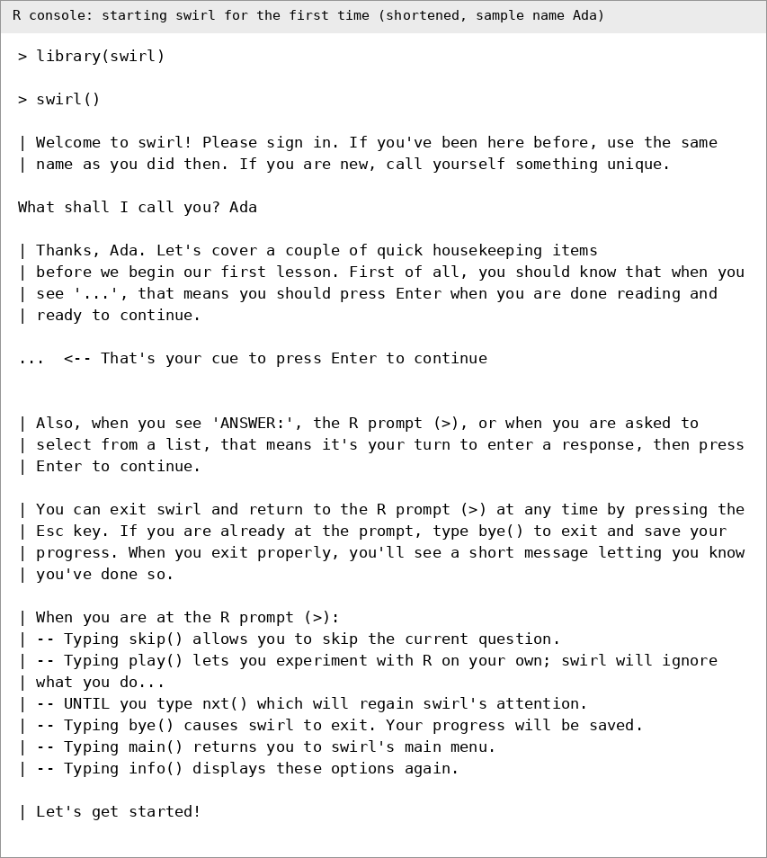
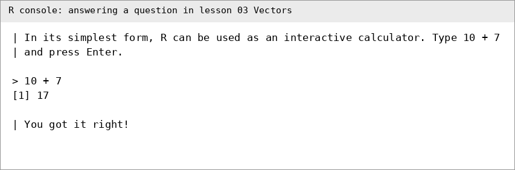
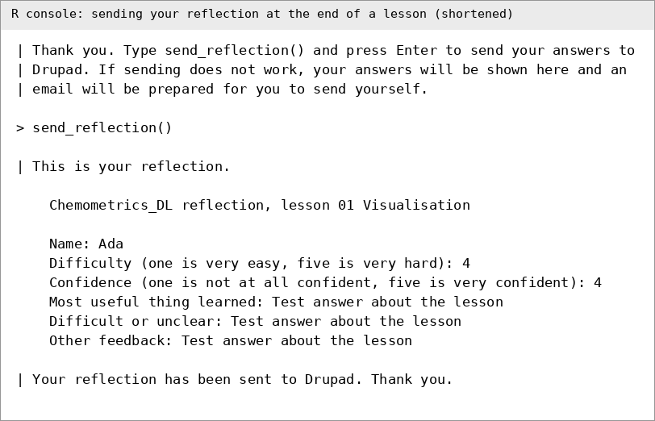

# Chemometrics in R: an interactive R course

This is a course of 22 short, interactive lessons that teach data analysis for chemistry with R. It runs inside R using the **swirl** package. You type short commands, swirl checks them, and the course moves on when you get them right. The lessons follow the weekly topics of the course. They start with setting up and basic statistics in R, then cover plotting, experimental design, data structures, calibration and limits of detection, unsupervised methods (PCA, MDS and clustering), supervised methods (PLS-DA), model validation, machine learning (SVM, trees and random forests), data wrangling and an independent workout.

This is a full manual. It assumes you have never used R. Choose your operating system below and follow its guide from start to finish. Then come back here to learn how the lessons work.

**Data protection reminder.** Never type personal information about yourself or anyone else into any online tool, prompt or free-text box. Follow the GDPR and the University of Manchester's data protection policies. Always double-check anything an online tool tells you before relying on it.

## Contents

1. [Choose your system and set up](#part-1-choose-your-system-and-set-up)
2. [Start the course](#part-2-start-the-course)
3. [How a lesson works](#part-3-how-a-lesson-works)
4. [Stopping and resuming](#part-4-stopping-and-resuming)
5. [The reflection at the end of each lesson](#part-5-the-reflection-at-the-end-of-each-lesson)
6. [The R script saved after each lesson](#part-6-the-r-script-saved-after-each-lesson)
7. [Lesson list and packages](#part-7-lesson-list-and-packages)
8. [Lesson 21, its worked example and datasets](#part-8-lesson-21-its-worked-example-and-datasets)
9. [Common problems and fixes](#part-9-common-problems-and-fixes)
10. [Credits, licence and contact](#part-10-credits-licence-and-contact)

## Part 1: Choose your system and set up

Pick the guide for your computer. Each one takes you through every step, with direct download links.

| Your computer | Guide | Where R comes from |
|-|-|-|
| Windows 10 or 11 | [Setting up on Windows](docs/Windows.md) | <https://cran.r-project.org/bin/windows/base/> |
| Mac (Apple silicon or Intel) | [Setting up on macOS](docs/macOS.md) | <https://cran.r-project.org/bin/macosx/> |
| Linux (Ubuntu, Debian, Fedora, Red Hat) | [Setting up on Linux](docs/Linux.md) | <https://cran.r-project.org/bin/linux/> |

RStudio Desktop, the friendly window for using R, is free and downloads from <https://docs.posit.co/ide/user/download.html>.

Each guide has the same six steps:

1. Install R. This must come first.
2. Install RStudio.
3. Choose a working folder.
4. Install the packages the course needs.
5. Download this course from the repository (<https://github.com/trivedi-group/Chemometrics-in-R>, branch **main**) and install it into swirl.
6. Come back here and start the course.

**Important: install R 4.5.3.** This course was tested from start to finish on R 4.5.3. Each system guide links to that exact version. Please use it, and do not install a newer R for this course, because newer versions have not been tested with these lessons.

## Part 2: Start the course

Do this every time you want to work on the course.

1. Open RStudio.
2. Set your working folder (see Step 3 of the guide for your system).
3. In the Console, type the following. Press Enter after each line.

   ```
   library(swirl)
   swirl()
   ```

4. If swirl says it sees variables saved in your workspace, type `ls()` to look, then `rm(list=ls())` to clear it, and then type `swirl()` again. This keeps old variables from interfering with a lesson.
5. swirl asks **What shall I call you?** Type a name and press Enter. **Use the same name every time**, with the same capital letters, so that swirl can remember your progress. The first time, swirl explains how it works. Press Enter whenever you see `...`.

   

   *This image shows real console output from the course, shortened, with the sample name Ada typed in.*

6. swirl lists the courses. Type the number next to **Chemometrics-in-R** (or the name you installed) and press Enter.
7. swirl lists the lessons, numbered 01 to 22. Type the number of the lesson you want and press Enter. Start with **01 Getting Started with swirl** and work in order. Lesson 22 is optional.

## Part 3: How a lesson works

swirl talks to you in lines that start with `|`. What you do next depends on what the screen shows.

| What you see | What to do |
|-|-|
| `...` | Press **Enter** when you have finished reading. |
| The `>` prompt after a question | Type the R command that the question asks for and press **Enter**. |
| `ANSWER:` | Type your answer and press **Enter**. |
| A numbered list | Type the number of your choice and press **Enter**. |
| A progress bar | Nothing to do. It shows how far through the lesson you are. |



*Real console output from lesson 02, shortened.*

### If your answer is wrong

swirl tells you and gives you another try, often with a hint. You can try as often as you like. The matching is flexible, so extra spaces and the choice between single and double quotation marks usually do not matter.

### Typing commands in swirl

- Type each command exactly as the lesson asks, and press Enter once.
- R is **case sensitive**. `Data` and `data` are different.
- If you press Enter before a bracket is closed, R shows a `+` instead of `>`. Press **Esc** and retype the command.
- Use the **up arrow** key to bring back your last command and edit it.

### Special swirl commands

You can type these at the `>` prompt at any time during a lesson.

| Command | What it does |
|-|-|
| `skip()` | Skips the current question. Use it only if you are truly stuck. |
| `play()` | Lets you experiment freely. swirl ignores what you type until you use `nxt()`. |
| `nxt()` | Returns to the lesson after `play()`. |
| `main()` | Goes back to the main menu. |
| `bye()` | Saves your progress and leaves swirl. |
| `info()` | Shows this list again. |
| `submit()` | Used in lessons where you edit a script. Press it after saving the script. |
| `reset()` | Used in script questions to restore the original script. |

### Script questions

A few lessons open a short R script in a window. Follow the instructions on screen, make the change, **save** the script, return to the Console, and type `submit()`. If you make a mess of it, type `reset()` and start that question again.

## Part 4: Stopping and resuming

To stop part way through a lesson, type `bye()` at the `>` prompt. swirl saves your progress. You can also press **Esc** and then type `bye()`.

To resume, open RStudio, then type:

```
library(swirl)
swirl()
```

Type **exactly the same name** as before. swirl then offers to **continue with your unfinished lesson**. Choose that option. If you type a different name, swirl treats you as a new student and starts a fresh record.

Always use `bye()` to leave a lesson, because that is the way swirl is designed to save your place.

## Part 5: The reflection at the end of each lesson

Each lesson ends with a short reflection of six questions. They ask for your name, how difficult you found the lesson, how confident you feel, what was most useful, what was unclear and any other feedback. Free-text answers are limited to 250 characters.

When the questions are done, type:

```
send_reflection()
```

swirl then emails your answers to Drupad Trivedi, who teaches the course, through a web relay. You see a copy of what was sent, followed by **Your reflection has been sent to Drupad. Thank you.**



*Real console output from lesson 01, shortened. The answers shown are test text.*

Please note:

- You need an **internet connection** to send the reflection.
- If sending fails, swirl shows your answers on screen and prepares an email in your own mail program, so that you can send it yourself. If no mail program opens, copy the text from the screen into an email to the address in Part 10.
- Please do **not** put personal or sensitive information in the free-text answers. Keep them about the course content.

## Part 6: The R script saved after each lesson

When you send your reflection, swirl also saves the commands from that lesson as an R script in your working folder. The file is called, for example:

```
Chemometrics lesson 01 script.R
```

Each model-answer command in the script has a comment above it, taken from the lesson, so that you can see what the command does. You can open the script in RStudio, run it again later, or use it as the starting point for your own analyses. Lines that read the course's data files point to the data inside the installed course, so they are written as comments for you to adapt to your own file locations.

If you cannot find the script, type `getwd()` to see your working folder and look there. If your working folder is inside a cloud-synced folder such as OneDrive, the lesson saves the script in a local folder instead and prints where it is.

## Part 7: Lesson list and packages

### Weekly schedule

Do the lessons for each week alongside that week's material. Lessons are numbered in week order, so within a week work through them in number order.

| Week | Topic | Lessons | How the lessons relate to the week |
|-|-|-|-|
| 1 | Setting up R and swirl | 01 Getting Started with swirl | You install R, RStudio, the packages and the course, and learn the swirl routine. Every later week depends on this working. |
| 2 | Basic statistics in R | 02 Vectors, 03 Vector arithmetics, 04 Descriptive Statistics, 05 Significance Tests, 06 Plotting in R | Vectors and arithmetic show how R stores and combines measurements. You then summarise replicate and quality control data, run significance tests, and draw figures that show the data honestly. |
| 3 | Experimental design and ANOVA | 07 ANOVA and Experimental Design | You plan replicated experiments and compare several groups with ANOVA and Tukey's test, using extraction yield data with one and two factors. |
| 4 | Data structures | 08 Factors, 09 Data Frames and Structures | Factors and data frames are how samples are stored with labels such as group, batch and analyst. Every later method expects data in this form. |
| 5 | Calibration and limits of detection | 10 Calibration Exercise, 11 Limits of Detection | You fit and check calibration lines, then use blanks and low concentration standards to estimate detection limits. |
| 6 | Unsupervised methods | 12 PCA, 13 MDS, 14 K Means Clustering, 15 Hierarchical Clustering | PCA and MDS reduce many variables to a map of the samples. K-means and hierarchical clustering then look for groups without using the sample labels. |
| 7 | Supervised methods | 16 PLSDA | You build a classification model that uses the sample labels, and read its scores and performance. |
| 8 | Model validation | 17 Validation Methods | You test whether a model will work on new samples, using training and test sets and cross validation. |
| 9 | Machine learning | 18 SVM, 19 Trees and Random Forests | Two further classification methods, so that you can compare them with PLS-DA from week 7 using the validation ideas from week 8. |
| 10 | Data wrangling and independent work | 20 Data Wrangling, 21 Independent Workouts | You reshape and clean data with dplyr and tidyr, then apply what you have learned to problems that you solve on your own. |
| Optional | Any time after week 2 | 22 ggplot2 Essentials | An introduction to the ggplot2 plotting system for students who want an alternative to base R graphics. |

### Lesson list and packages

Work through the lessons in order. The week column shows which week of the course each lesson supports. The packages listed are the ones each lesson loads. They are all covered by the package installation in your system guide, so you do not need to install anything extra.

| No. | Week | Lesson | Packages used |
|-|-|-|-|
| 01 | 1 | Getting Started with swirl | none beyond swirl |
| 02 | 2 | Vectors | none |
| 03 | 2 | Vector arithmetics | none |
| 04 | 2 | Descriptive Statistics | none |
| 05 | 2 | Significance Tests | none |
| 06 | 2 | Plotting in R | none |
| 07 | 3 | ANOVA and Experimental Design | none |
| 08 | 4 | Factors | none |
| 09 | 4 | Data Frames and Structures | none |
| 10 | 5 | Calibration Exercise | none |
| 11 | 5 | Limits of Detection | none |
| 12 | 6 | PCA | mixOmics |
| 13 | 6 | MDS | ggpubr, dplyr, magrittr |
| 14 | 6 | K Means Clustering | none |
| 15 | 6 | Hierarchical Clustering | none |
| 16 | 7 | PLSDA | mixOmics |
| 17 | 8 | Validation Methods | tidyverse, caret |
| 18 | 9 | SVM | e1071 |
| 19 | 9 | Trees and Random Forests | rpart, randomForest |
| 20 | 10 | Data Wrangling | dplyr, tidyr |
| 21 | 10 | Independent Workouts | e1071 |
| 22 | optional | ggplot2 Essentials | ggplot2 |

`rpart` normally comes with R itself, and the package installation in your system guide installs it anyway if it is missing.

## Part 8: Lesson 21, its worked example and datasets

Lesson 21 is an independent workout. It asks you to apply what you have learned without much hand-holding.

It starts with a worked example on **synthetic** data, meaning numbers generated by a computer script, not real measurements. The file `synthetic_example.csv` has 80 samples in four groups (G1 to G4), with ten numeric variables named `var01` to `var10`. The script that made it, `make_synthetic_data.R`, is in the lesson folder, so you can see exactly how the data were built. The example walks you through looking at the data, PCA, an analysis of variance for one variable, a post-hoc comparison and a cross-validated support vector machine.

The lesson then gives you three real datasets to analyse on your own. They come with the course, so there is nothing to download.

| Dataset | File | Samples | Variables | Groups |
|-|-|-|-|-|
| 1, stem cell media study | `Dataset1_mediastudy.csv` | 140 | 58 small molecules | media E6, E6R, E8 and E8R |
| 2, knock out mice study | `Dataset2_micestudy.csv` | 45, including 13 pooled QCs | 66 | KO, KT (knock out treated), WT, WTT (wild type treated) and QC |
| 3, oil and fat study | `Dataset3_oilstudy.csv` | 8 | 2683 | Liquid_Oil, Solid_Oil, fas1 to fas3, lb1 to lb3 |

Inside the lesson you load them with `load_dataset(1)`, `load_dataset(2)` and `load_dataset(3)`. Near the end, `save_datasets()` copies the three files into your working folder, or into a local folder if yours is cloud-synced, and prints the `read.csv()` commands that load them again after the lesson. In every file each row is one sample. Dataset 3 was originally stored the other way round and has been turned round for you.

The lesson also invites you to try KNN yourself if you feel confident.

## Part 9: Common problems and fixes

> This section was written from testing the course. It is not a record of student reports. If you meet a problem that is not listed, email the address in Part 10 with a copy of the red error text.

**`Error: could not find function "swirl"` or `there is no package called 'swirl'`.**
Run `library(swirl)` first. If that fails, run `install.packages("swirl")`.

**`Error in library(xxx) : there is no package called 'xxx'`.**
Install the package with `install.packages("xxx")`, replacing `xxx` with the name shown. For `mixOmics`, use `BiocManager::install("mixOmics")`. Then restart the lesson.

**swirl does not remember where I was.**
The name you typed was different, including capitals and spaces. Type exactly the same name every time.

**The course is not in the course list.**
The installation did not finish, or you installed under a different name. Run `install_course_zip(file.choose())` again and read the messages. If you used GitHub, look for a name starting with **Chemometrics in R**.

**The file window does not appear when I run `file.choose()`.**
It may be hidden behind another window. If not, give the path directly. See Step 5 of your system guide. On Windows, use forward slashes (`/`) or double backslashes (`\\`).

**My answer looks right but swirl says it is wrong.**
Compare what you typed with the question character by character. Check capital letters, brackets and quotation marks. If you are using `play()`, type `nxt()` to return. If you really are stuck, `skip()` moves you on.

**I typed something and nothing happens, and the prompt is `+`.**
A bracket or quotation mark was left open. Press **Esc** and retype the command.

**I see red text that says `Warning` or a message about something being deprecated.**
Warnings are not errors. Lesson 03 discusses the warning R gives when vector lengths do not match. Lesson 06 can show a warning that a zero-length arrow was skipped, and the lesson explains why. The commands still work. Only `Error` messages need action.

**No graph appears, or it is very small.**
Look in the **Plots** pane in RStudio. Click **Zoom** to enlarge it. If the pane is hidden, drag its edge to make it bigger.

**The reflection could not be sent.**
Check your internet connection and type `send_reflection()` again. If it still fails, follow the on-screen instructions to send the email yourself.

**I cannot find the saved script.**
Type `getwd()`. The script is in that folder. See Part 6.

**swirl says I have variables in my workspace.**
Type `rm(list=ls())` and press Enter, then type `swirl()` again.

**Installation of a package fails on Linux.**
A system library is probably missing. Read the red text for the missing library name and install it with your package manager. See the system library notes in the Linux guide.

**On Windows, installing, saving or running lessons gives timeouts, "cannot open file" or "permission denied" errors, and my folders sync to the cloud (OneDrive, iCloud Drive, Dropbox, Google Drive).**
Cloud sync can lock or delay a file while R is reading or writing it. Keep everything the course touches on your own disk.

1. Move the downloaded zip to a local folder before installing. Create `C:/Chemometrics`, copy the zip there, and run `install_course_zip()` on that copy. If the zip shows a cloud icon, right-click it in File Explorer and choose **Always keep on this device**, and wait until the icon changes.
2. Use that same local folder as your working folder (see Step 3 of your system guide). If your working folder is cloud-synced, the lesson saves the script in a local folder instead and tells you where.
3. Check where R keeps its packages by typing `.libPaths()`. swirl and the course are installed inside that library. If a path contains OneDrive, iCloud, Dropbox or Google Drive, make a local library and put it first:

```
dir.create("C:/Rlibs", showWarnings = FALSE)
.libPaths(c("C:/Rlibs", .libPaths()))
```

   Then install `swirl` and the course packages again. To make this permanent, type `file.edit("~/.Renviron")`, add the line `R_LIBS_USER=C:/Rlibs` on its own line, save, and restart R.
4. If errors continue, pause cloud sync for an hour while you install the course, then resume it.

**On macOS, installing, saving or running lessons gives timeouts, "cannot open file" or "permission denied" errors, and my folders sync to the cloud (OneDrive, iCloud Drive, Dropbox, Google Drive).**
Cloud sync can lock or delay a file while R is reading or writing it. Keep everything the course touches on your own disk.

1. Move the downloaded zip to a local folder before installing. Create a folder in your home folder, such as `~/Chemometrics`, copy the zip there, and run `install_course_zip()` on that copy. If the zip shows a cloud icon, click the cloud icon in Finder, or right-click it and choose **Download Now**, and wait until the icon changes.
2. Use that same local folder as your working folder (see Step 3 of your system guide). If your working folder is cloud-synced, the lesson saves the script in a local folder instead and tells you where.
3. Check where R keeps its packages by typing `.libPaths()`. swirl and the course are installed inside that library. If a path contains OneDrive, iCloud, Dropbox or Google Drive, make a local library and put it first:

```
dir.create("~/Rlibs", showWarnings = FALSE)
.libPaths(c("~/Rlibs", .libPaths()))
```

   Then install `swirl` and the course packages again. To make this permanent, type `file.edit("~/.Renviron")`, add the line `R_LIBS_USER=~/Rlibs` on its own line, save, and restart R.
4. If errors continue, pause cloud sync for an hour while you install the course, then resume it.

**R or RStudio crashed during a lesson.**
Reopen RStudio, run `library(swirl)` and `swirl()`, and sign in with the same name. You should be able to continue from the last question.

## Part 10: Credits, licence and contact

### Credits

This course runs on **swirl**, an R package created by the swirl team at Johns Hopkins University (<https://swirlstats.com/>). The lesson files in this course use swirl's lesson format. The author named in each lesson file is:

| Lessons | Author named in the lesson file |
|-|-|
| 01 to 22 | Drupad Trivedi |

Lessons 01 to 07, 09, 11, 14, 15, 19, 20 and 22 were written new for 2026 with synthetic data.

### Licence

The full licence notice is in `LICENSE.txt` in the course folder. In summary:

Chemometrics in R, copyright © 2026 Drupad Trivedi, The University of Manchester. All rights reserved.

1. **Permitted use.** This material is provided to students enrolled on the relevant course at the University of Manchester, for their own personal study on that course.
2. **Not permitted.** Without prior written permission from the author and the University of Manchester, you may not copy, share, publish, upload, redistribute, sell or reuse this material, in whole or in part, or any adaptation of it, outside the course.
3. **Third-party software.** The lessons run in R and use swirl and other publicly available R packages. These are separate software, provided under their own licences, and they are not covered by this notice.
4. **No warranty.** The material is provided as it is, with no warranty of any kind.
5. **Permissions.** To request permission, email drupad.trivedi@manchester.ac.uk.

### Contact

Drupad Trivedi, The University of Manchester: <drupad.trivedi@manchester.ac.uk>

For course discussions, use the Canvas discussion boards. For problems with the course itself, email the address above and include the lesson number and a copy of any red error text, with no personal information in it.
