# Chemometrics in R: running the course on Posit Cloud

Posit Cloud runs RStudio in your web browser, so you do not need to install R or RStudio on your own computer. It is a good choice if you cannot install software, or if your computer is slow or shared. Everything you do is saved in a Posit Cloud project and is there again the next time you log in.

This guide takes you through every step, with a picture for each one. The red boxes show where to look or click.

**Data protection reminder.** Never type personal information about yourself or anyone else into any online tool, prompt or free-text box. Follow the GDPR and the University of Manchester's data protection policies.

## What the free plan gives you

At the time of writing (October 2026), the free plan includes:

| Limit | Free plan |
|-|-|
| Compute hours per month | 25 |
| Memory (RAM) per project | 1 GB |
| Processors (CPU) per project | 1 |
| Projects | 25 |

With the free settings, one hour of work uses about one compute hour, so 25 hours a month is enough for this course if you close your project when you finish. The 1 GB of memory is enough for every lesson, but only if you free memory between lessons, as shown in Step 6. Posit can change these limits, so check <https://posit.cloud/plans/free> if something looks different.

## Step 1: Sign up or log in

1. Go to <https://posit.cloud> and click **Sign Up**, or **Log In** if you already have an account.
2. Choose the free plan, called **Cloud Free**.
3. After logging in you see **Your Workspace**.

## Step 2: Create a new project

1. In Your Workspace, click **New Project** at the top right.

   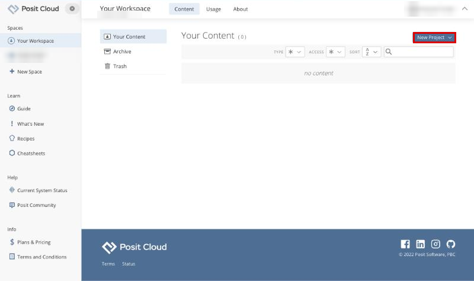

2. Choose **New RStudio Project**.

   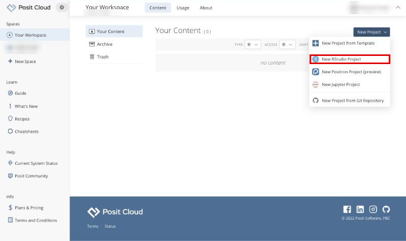

3. Wait while Posit Cloud sets up the project. This takes about half a minute.

   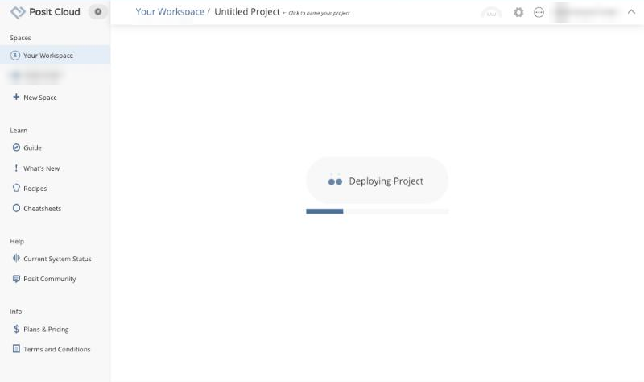

## Step 3: Name the project

1. When RStudio opens, click **Untitled Project** at the top of the page.

   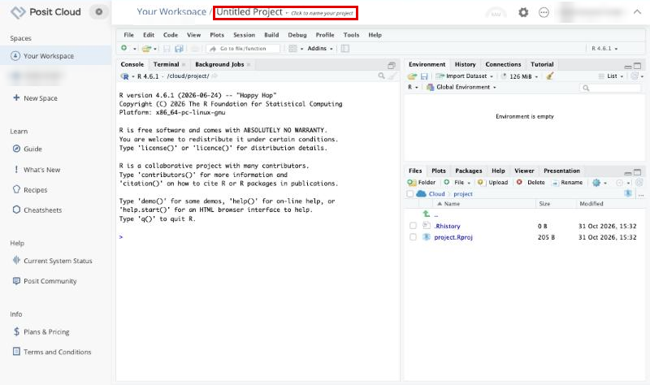

2. Type a name, for example `Chemometrics in R`, and press **Enter**.

   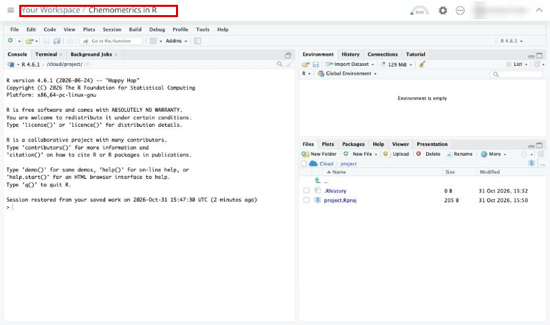

RStudio works exactly as it does on a computer. The **Console**, on the left, is where you type commands. The **Files**, **Plots** and **Packages** tabs are at the bottom right.

## Step 4: Switch to R 4.5.3

This course was tested on R 4.5.3. A new Posit Cloud project starts with the newest R, so switch to 4.5.3 first.

1. Click the R version at the top right of RStudio, for example **R 4.6.1**, and choose **R version 4.5.3**.

   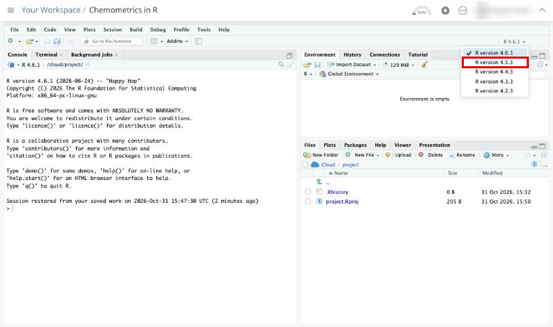

2. When RStudio asks whether to save the workspace image, click **Don't Save**.

   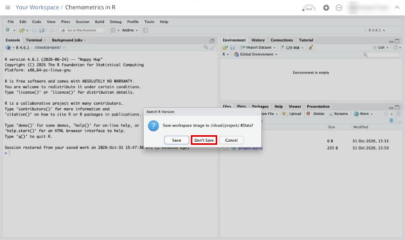

3. R restarts. The Console and the top right of RStudio now both show **R 4.5.3**.

   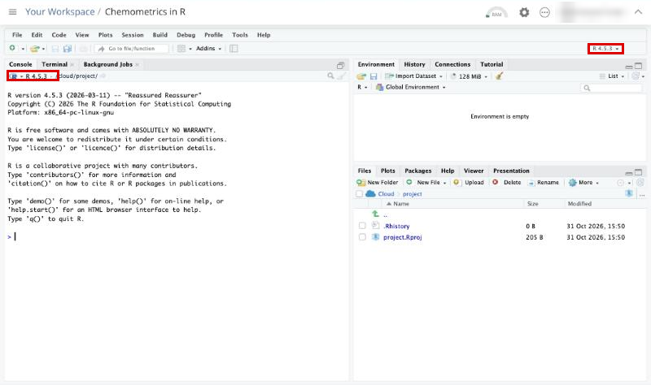

If R 4.5.3 is not in the list, choose the closest 4.5 version and tell your lecturer which one you used.

## Step 5: Install the packages the course needs

1. Click in the Console, type this command exactly, and press **Enter**:

   ```
   source("https://raw.githubusercontent.com/trivedi-group/Chemometrics-in-R/main/install_packages.R")
   ```

   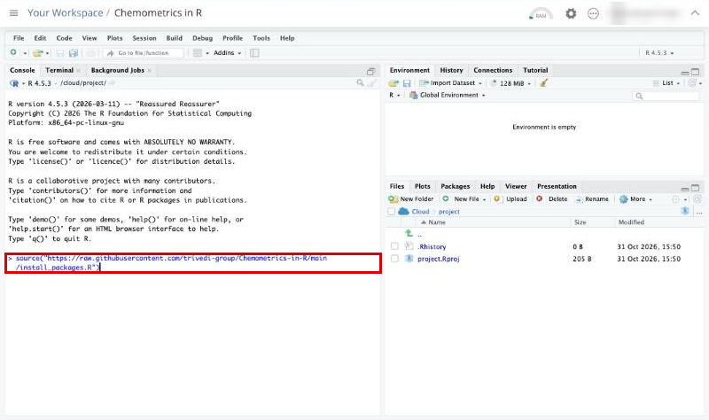

2. R now installs every package the course uses. A lot of text scrolls past. This took about five minutes in testing. Wait until the `>` prompt comes back at the bottom of the Console.

   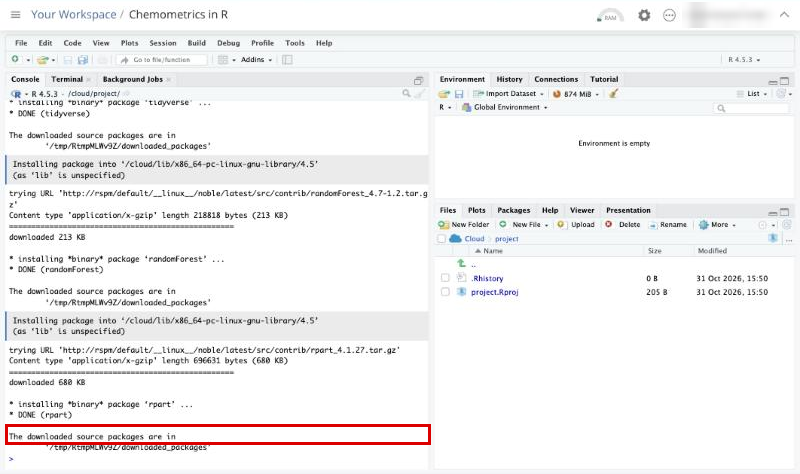

3. Check that everything installed. Type this command and press **Enter**:

   ```
   sapply(c("swirl","mixOmics","ggpubr","dplyr","magrittr","ggplot2","e1071","caret","tidyverse","randomForest","rpart","tidyr"), requireNamespace, quietly = TRUE)
   ```

   Every name should show `TRUE`. Any `FALSE` shows a package to install again with `install.packages("name")`, or `BiocManager::install("mixOmics")` for mixOmics.

   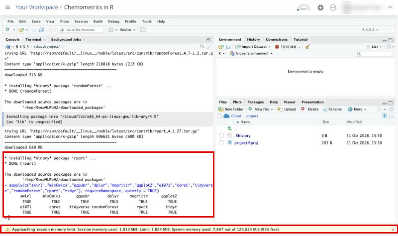

That check loads every package at once, so a yellow bar may appear at the bottom saying **Approaching session memory limit**. This is expected. The next step frees the memory.

You only need to install the packages once. They stay in your project.

## Step 6: Free memory, after installing and before every lesson

The free plan gives each project 1 GB of memory. To keep each lesson well inside that limit, do these two things after installing, and again before you start each lesson:

1. Click **Session**, then **Clear Workspace...**, and confirm. This removes the objects from the last lesson.
2. Click **Session**, then **Restart R**. This unloads the packages.

   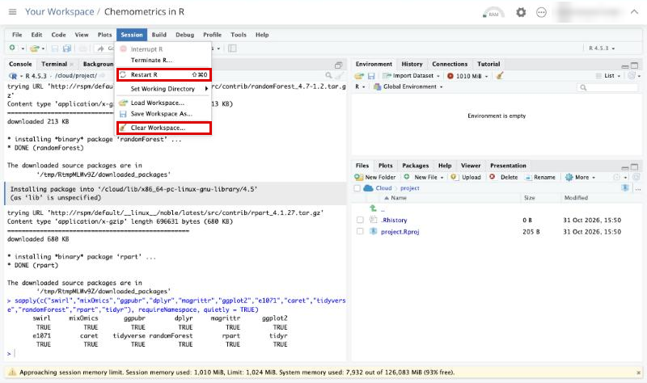

Use the **Session** menu rather than keyboard shortcuts, because your web browser may catch the shortcut before RStudio sees it.

## Step 7: Download the course and install it into swirl

1. In the Console, type this command and press **Enter**. It downloads the course into your project.

   ```
   download.file("https://github.com/trivedi-group/Chemometrics-in-R/archive/refs/heads/main.zip", "Chemometrics-in-R-main.zip", mode = "wb")
   ```

   The file `Chemometrics-in-R-main.zip` appears in the **Files** tab.

   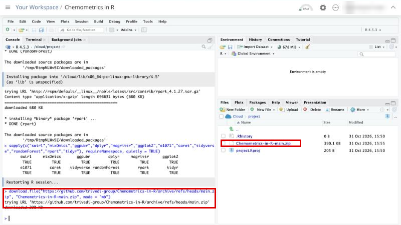

2. Load swirl and install the course, pressing **Enter** after each line:

   ```
   library(swirl)
   install_course_zip("Chemometrics-in-R-main.zip")
   ```

   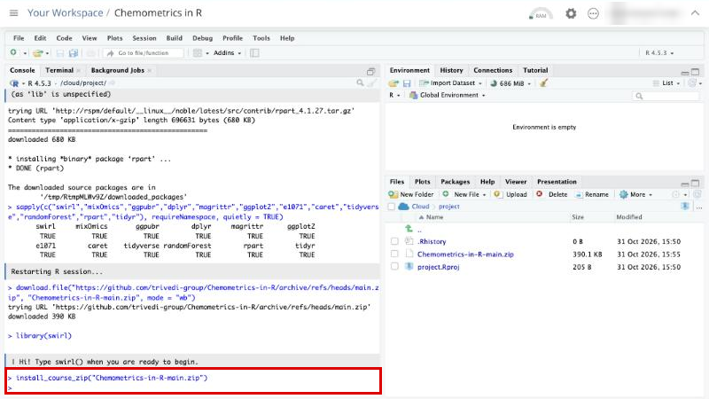

You only need to do this once. To update the course later, run the same three commands again.

## Step 8: Start the course

1. Type `swirl()` and press **Enter**. swirl asks what to call you. Type your name and press **Enter**. Use exactly the same name every time, including capital letters, so that swirl can find your progress.

   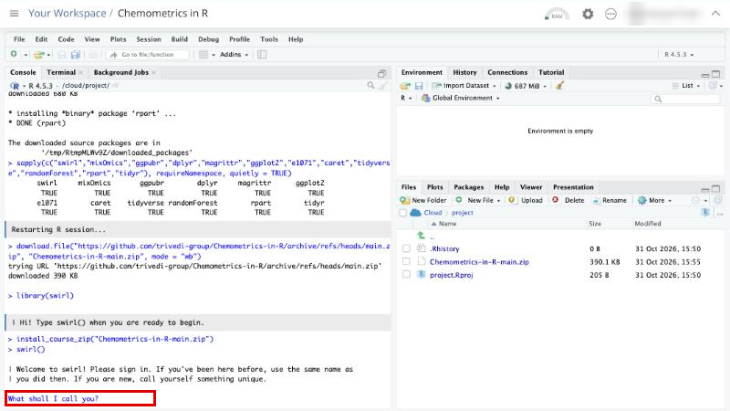

2. Read swirl's short introduction, pressing **Enter** whenever you see `...`. When it asks you to choose, type the number and press **Enter**.
3. Choose the course **Chemometrics-in-R-main** by typing its number.

   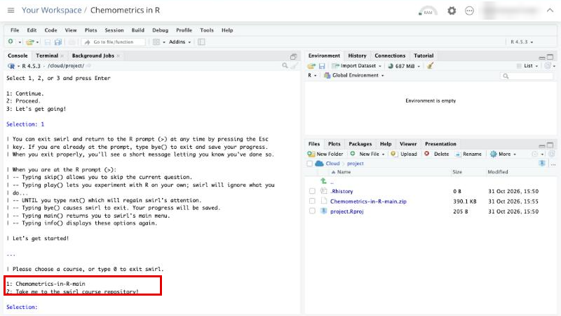

4. Choose a lesson by typing its number. Lesson 01 shows you how swirl works. The README explains which lessons go with which week.

   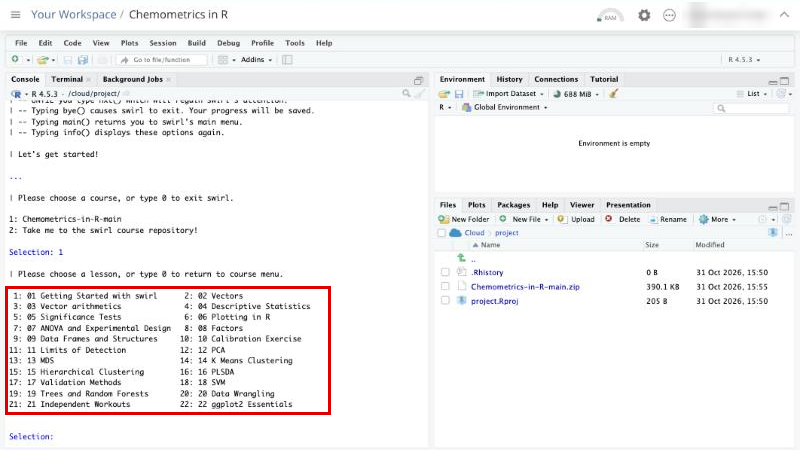

   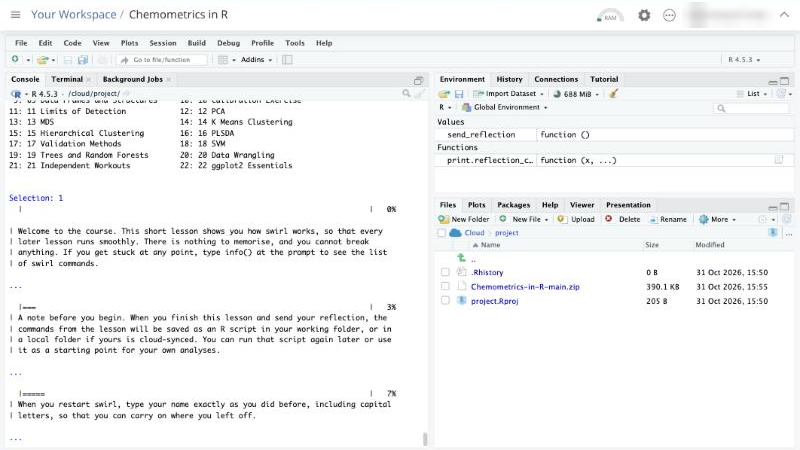

## Step 9: Answering questions

- When you see `...`, press **Enter** to carry on.
- When you see the `>` prompt, type the command you are asked for and press **Enter**.
- If your answer is not what swirl expects, it says so and gives you a hint. Read the hint and try again.

  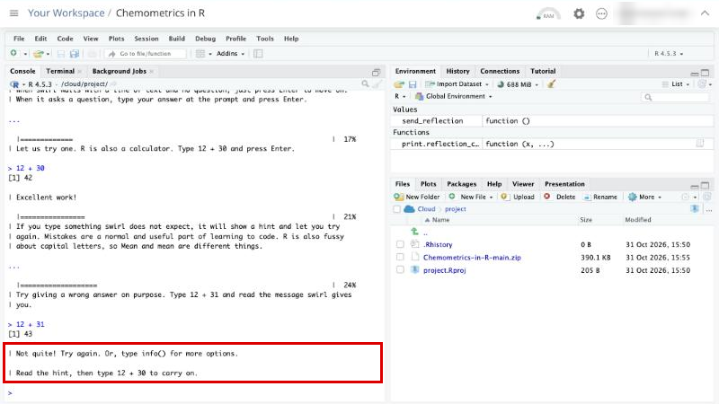

- For a multiple-choice question, type the number of your answer and press **Enter**.

  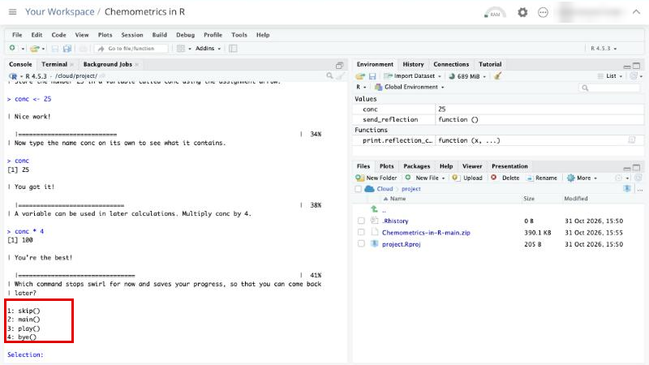

- Plots appear in the **Plots** tab at the bottom right. Click **Zoom** to see a plot larger.

  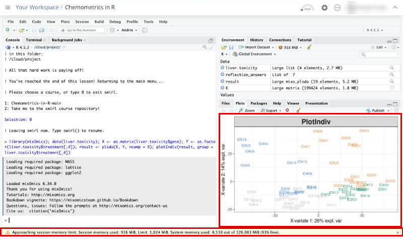

## Step 10: The reflection at the end of each lesson

Each lesson ends with a short reflection. Type your answers as asked, then type `send_reflection()` and press **Enter**. Do not include personal or sensitive information about yourself or anyone else in your answers.

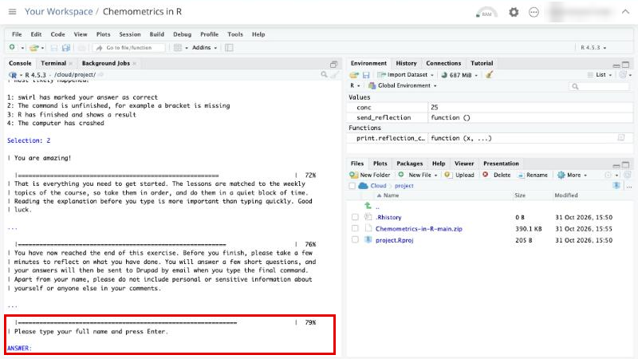

swirl confirms that your reflection has been sent, and saves the commands from the lesson as an R script. The script appears in the **Files** tab, in your project folder, `/cloud/project`.

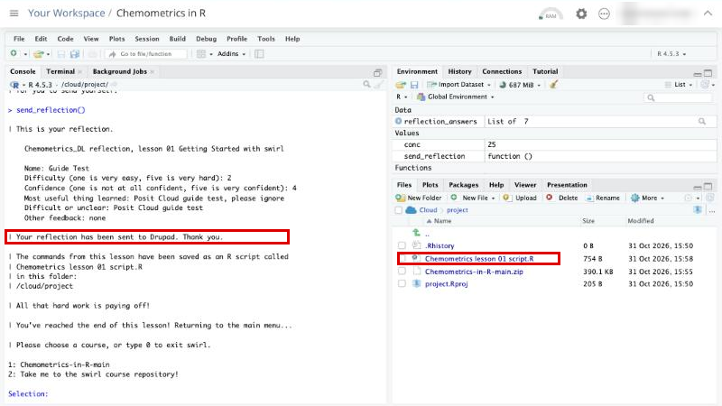

To keep a copy of a file on your own computer, tick it in the **Files** tab, click **More**, then **Export...**.

In lesson 21, `save_datasets()` copies the three datasets into the same project folder, where you can export them in the same way.

## Stopping and coming back

- To stop in the middle of a lesson, type `bye()`. Your progress is saved in your project.
- When you have finished for the day, close the browser tab. A project that is left alone goes to sleep after about 15 minutes, and stops using compute hours.
- When you come back, open the project from **Your Workspace**. If it says that the project went to sleep, click **Resume**.

  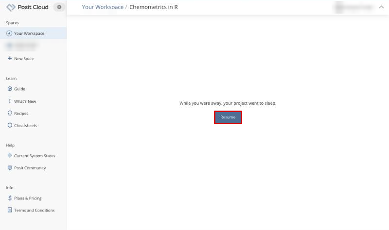

- Then type `library(swirl)` and `swirl()`, and sign in with exactly the same name. swirl offers to carry on where you left off.

## Common problems on Posit Cloud

**A yellow bar says Approaching session memory limit, or R restarts by itself.**
Your project is close to its 1 GB of memory. Save anything you need, then do Step 6: **Session**, **Clear Workspace...**, then **Session**, **Restart R**. Start swirl again with the same name to carry on.

**The R version at the top right has changed.**
Posit Cloud sometimes moves projects to a newer R when an old version stops being supported. Switch back to R 4.5.3 if it is offered (Step 4). If packages then go missing, run the installation command in Step 5 again.

**A keyboard shortcut did something unexpected.**
Your web browser may use the same shortcut. Use RStudio's menus instead.

**You have run out of compute hours.**
The hours reset each month. Close your project whenever you stop working so that it does not keep using hours.

For other problems, see **Common problems and fixes** in the [main guide](../README.md#part-9-common-problems-and-fixes).
